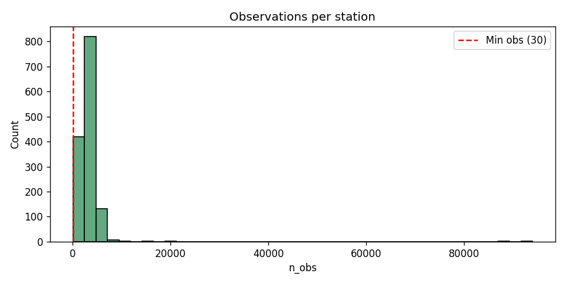
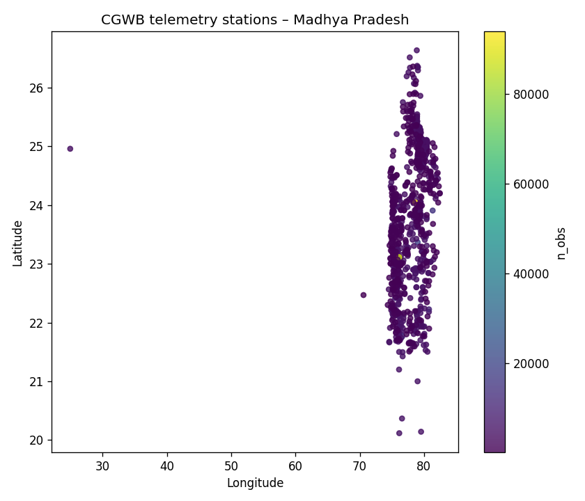

# Phase-1 EDA & Data-Quality Report
**AI-Enabled Water Well Predictor – Madhya Pradesh**

## 1. Overview

| Item | Value |
|------|-------|
| Total stations discovered | 1385 |
| Stations retained (≥ 30 observations) | 1385 |
| Feature matrix | `features_lag_rolling.parquet` |

## 2. Measurement Convention (Important)

The column `Groundwater Level Telemetry 6 Hourly (meter)` contains a high proportion of negative values in the published CGWB telemetry files.

**A high negative rate alone does not scientifically prove that the values represent relative hydraulic head.**

Possible explanations that still require verification against official CGWB / NWIC documentation:

- Sensor zero / installation reference below ground level
- Signed depth relative to a local datum
- Data-logger configuration that stores head relative to the transducer

**Pipeline decision (transparent and reversible):**

- The original signed value is stored as `wl_raw` and is **never** automatically converted with `abs()`.
- Extreme magnitudes and large inter-observation jumps are only **flagged**.
- Downstream models currently receive the signed series.

## 3. Quality flags

| Flag | Meaning |
|------|---------|
| `flag_extreme_magnitude` | Absolute value outside [0.05, 150.0] m |
| `flag_large_jump` | Change from previous reading of the same station > 10.0 m |
| `flag_bad_coords` | Latitude / longitude missing or outside Madhya Pradesh bounding box |
| `flag_any_suspicious` | Logical OR of the above |

## 4. Visualisations

## 5. Next steps (Phase 2)

- Chronological train / validation / test split
- Train Random Forest, XGBoost, CatBoost
- Select the single best model by validation MAE
- Evaluate on the untouched test set
- Integrate forecasts into the Streamlit application

*Data source: Central Ground Water Board (CGWB) telemetry. Academic use only.*
